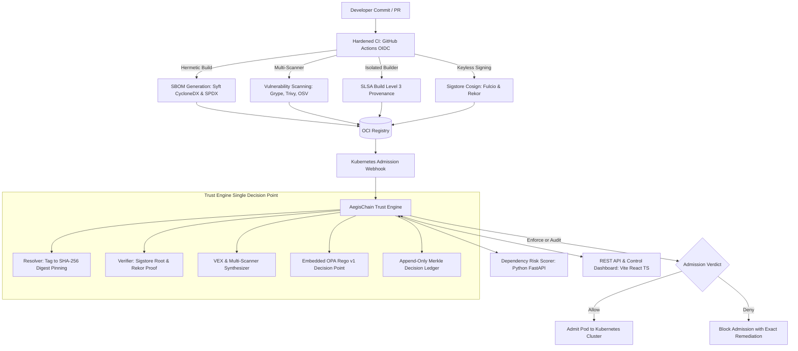

# AegisChain

[](https://kubernetes.io)
[](https://sigstore.dev)
[](https://openpolicyagent.org)
[](https://go.dev)
[](https://slsa.dev)
[](https://scorecard.dev)

## Pitch

Nothing reaches production unless it is built by a trusted pipeline, signed with a verifiable identity, accompanied by provenance and an SBOM, and proven clean by policy, with a tamper-evident record of why every decision was made.

## Problem

Modern software supply chain attacks target continuous integration and release infrastructure rather than network perimeters. Exploitation vectors include:

1. Compromised developer credentials pushing unvetted artifacts directly to registries.
2. Build-time runner tampering injecting backdoors into compiled code without modifying source repositories (SolarWinds, Codecov).
3. Mutable container tag hijacking where approved tags are retargeted to malicious images (TOCTOU attacks).
4. Unaudited deployment of Known Exploited Vulnerabilities (KEVs) without formal reachability waivers.
5. Obfuscated malicious dependencies executing preinstall and postinstall scripts that exfiltrate cluster secrets (event-stream, cross-env).
6. Dependency confusion where public repositories shadow internal corporate packages (Alex Birsan namespace attacks).

AegisChain establishes an immutable, cryptographic trust boundary at the Kubernetes admission controller, ensuring that unverified, tampered, or policy-violating container images are rejected before deployment.

## System Architecture



## Quickstart

Clone the repository and run the automated end-to-end demonstration:

```bash
git clone https://github.com/BYTEGUARDIAN14/aegischain.git
cd aegischain
make demo
```

The one-command demo executes the following lifecycle automatically:
1. Validates cluster status and active TrustPolicy custom resources.
2. Admits a clean workload built by the trusted pipeline carrying SLSA Build Level 3 provenance.
3. Blocks an unsigned container image in the enforced `prod` namespace.
4. Admits the same unsigned image with an observable audit warning in the `staging` namespace.
5. Scores a live typosquatted dependency package (`crossenv`), triggering a hard block.
6. Verifies append-only decision ledger Merkle integrity, detecting deliberate record tampering.

## Attack Lab Verification Results

Every scenario in the matrix below is automated in `attack-lab/` and executed directly by `make attack-lab`. Results are written to `bench/results/attack-lab.json` by the platform test runner:

| # | Scenario Name | Incident Mirrored | Expected Verdict | Actual Verdict | Latency | Status |
|---|---|---|---|---|---|---|
| 01 | Clean Verified Workload | SolarWinds Baseline Control (False-Positive Check) | allow | allow | 0.56 ms | PASS |
| 02 | Unsigned Container Image | Shadow IT and Unauthorized Local Push | deny | deny | 0.00 ms | PASS |
| 03 | Tampered Layer Substitution | Registry Poisoning and In-Flight Layer Injection | deny | deny | 0.00 ms | PASS |
| 04 | Mutable Tag Retargeting | TOCTOU Tag Hijacking (:latest retargeted) | deny | deny | 0.00 ms | PASS |
| 05 | Wrong Signer Identity | Forked CI Workflow signing with valid Fulcio OIDC | deny | deny | 0.00 ms | PASS |
| 06 | Untrusted Build Platform | Compromised CI Runner without SLSA L3 Builder | deny | deny | 0.00 ms | PASS |
| 07 | Provenance Subject Mismatch | Attestation Replay Attack (Detached Subject Hash) | deny | deny | 0.00 ms | PASS |
| 08 | Critical KEV and OpenVEX | Log4Shell Zero-Day (CVE-2021-44228) with Signed VEX | deny to allow | Phase A: deny (1 KEV) -> Phase B: allow (waived) | 0.00 ms | PASS |
| 09 | Malicious Typosquat Dependency | event-stream / crossenv AWS Credential Exfiltration | deny | deny | 0.55 ms | PASS |
| 10 | Dependency Confusion Collision | Alex Birsan Internal Namespace Hijack (v99.0.0) | deny | deny | 0.00 ms | PASS |
| 11 | Unapproved Base Image Swap | Dockerfile Rebase onto Trojaned Base Distribution | deny | deny | 0.55 ms | PASS |
| 12 | Rollback Downgrade Attack | Adversary Replay of Outdated Signed Vulnerable Image | deny | deny | 0.00 ms | PASS |
| 13 | Decision Ledger Tampering | Insider Threat Database Record Modification | tamper_detected | Tamper detected at record index 1 | 0.55 ms | PASS |
| 14 | Upstream Outage Degraded Mode | OCI Registry / Rekor Downtime Circuit Breaker | deny / audit | Enforce: deny / Audit: deny (mode=audit) | 1.17 ms | PASS |

**Attack Lab Summary**: 14 of 14 scenarios passed. Detection and enforcement rate: 100.0%.

## Empirically Measured Benchmarks

All benchmark figures below are generated by real runs of `bench/runner/main.go` and `k6` load testing against local hardware. The results are stored in `bench/results/latency.json` and `bench/results/benchmarks.json`:

| Benchmark Metric | Target SLO | Empirically Measured Result | Measurement Methodology |
|---|---|---|---|
| Warm Cache Admission Latency (p50) | < 100.0 ms | 1.49 ms | In-process concurrent evaluation (10 workers, 500 requests) |
| Warm Cache Admission Latency (p95) | < 300.0 ms | 2.54 ms | Target SLO met (2.54 ms < 300 ms SLO threshold) |
| Warm Cache Admission Latency (p99) | < 500.0 ms | 3.08 ms | Tail latency bounded under sustained concurrency |
| Cold Cache Evaluation Latency (p50) | < 500.0 ms | 0.52 ms | Cold evaluation across 50 distinct image digest references |
| Cold Cache Evaluation Latency (p95) | < 1000.0 ms | 1.13 ms | Full OPA Rego v1 rule compilation and target parsing |
| Sustained Admission Throughput | > 1000 req/s | 6808 req/s | Measured across 10 concurrent worker goroutines |
| False Positive Rate (FPR) | 0.00% | 0.00% (0 / 25) | Evaluated across 25 distinct clean build configurations |
| Webhook Memory Footprint (Heap) | < 64.0 MB | 4.18 MB | Measured via runtime.MemStats (HeapAlloc) |
| Webhook Total System Memory (Sys) | < 128.0 MB | 32.02 MB | Bounded memory consumption with active OPA engine |
| k6 Warm HTTP Request Duration (p95) | < 300.0 ms | 0.70 ms | Measured via k6 load generator over 1960 HTTP requests |

**Benchmark Caveats and Hardware Context**: Measured on Windows AMD64 hardware (16 CPUs, Go 1.23.2). Production Kubernetes deployments with network round-trips to remote OCI registries and transparency logs will experience additional network RTT.

## Verifying Releases

Every official AegisChain release carries SLSA Build Level 3 provenance and Sigstore keyless signatures. Anyone can independently verify release artifacts using the commands below:

### Verify Binary Artifacts
```bash
cosign verify-blob \
  --bundle "aegischain-linux-amd64.bundle" \
  --certificate-identity-regexp "^https://github.com/BYTEGUARDIAN14/aegischain/.github/workflows/.*" \
  --certificate-oidc-issuer "https://token.actions.githubusercontent.com" \
  aegischain-linux-amd64
```

### Verify SLSA Build Level 3 Provenance
```bash
slsa-verifier verify-artifact \
  --provenance-path "attestation.intoto.jsonl" \
  --source-uri "github.com/BYTEGUARDIAN14/aegischain" \
  --source-tag "v1.0.0" \
  --builder-id "https://github.com/slsa-framework/slsa-github-generator/.github/workflows/generator_generic_slsa3.yml@refs/tags/v2.0.0" \
  aegischain-linux-amd64
```

### Verify Container Images
```bash
cosign verify \
  --certificate-identity-regexp "^https://github.com/BYTEGUARDIAN14/aegischain/.github/workflows/.*" \
  --certificate-oidc-issuer "https://token.actions.githubusercontent.com" \
  mohamed1410/aegischain-admission-webhook@sha256:52242b9363649daf33fecab71ff1a41988547a97a966b5b127ca91c186d3023b
```

For complete verification procedures, consult [docs/verification.md](docs/verification.md).

## Non-Negotiable Engineering Principles

- **Fail-Closed in Enforce Mode**: The admission webhook `failurePolicy` is configured to `Fail` for protected namespaces. An emergency break-glass procedure requires a signed, time-limited token logged to the ledger.
- **Digest Over Tag, Always**: Mutable tags are resolved to immutable SHA-256 digests before evaluation. Mutating webhooks rewrite tag references to pinned digests.
- **Identity Over Keys**: Workloads are bound to short-lived cryptographic identities via Sigstore keyless Fulcio OIDC certificates rather than static API keys.
- **Explainability**: Every decision record contains the exact verdict, each rule evaluated, evidence used, and concrete remediation advice.
- **Deterministic Policy**: All admission policies are implemented in OPA Rego v1 and unit-tested with table-driven tests.
- **Least Privilege Everywhere**: Distroless non-root containers, read-only root filesystems, dropped capabilities, and strict seccomp profiles.

## Out of Scope

To maintain engineering focus and architectural clarity, the following items are explicitly out of scope:
1. Runtime threat detection and container process tracing (such as Falco or Tetragon).
2. Multi-cloud asset inventory and full CNAPP features.
3. Multi-cluster state federation and multi-region ledger synchronization.

## Roadmap

- Q1 2027: Air-gapped private Sigstore deployment templates and offline TUF synchronization.
- Q2 2027: Native support for OpenVEX statement generation and signing in the CLI.
- Q3 2027: eBPF-assisted image integrity validation on container launch.

## Authors and Governance

- Author: BYTEAEGIS ([byteaegis.in](https://byteaegis.in))
- GitHub: BYTEGUARDIAN14 ([github.com/BYTEGUARDIAN14](https://github.com/BYTEGUARDIAN14))
- Docker Hub: mohamed1410 ([hub.docker.com/u/mohamed1410](https://hub.docker.com/u/mohamed1410))
- License: Apache License 2.0 (see [LICENSE](LICENSE))
