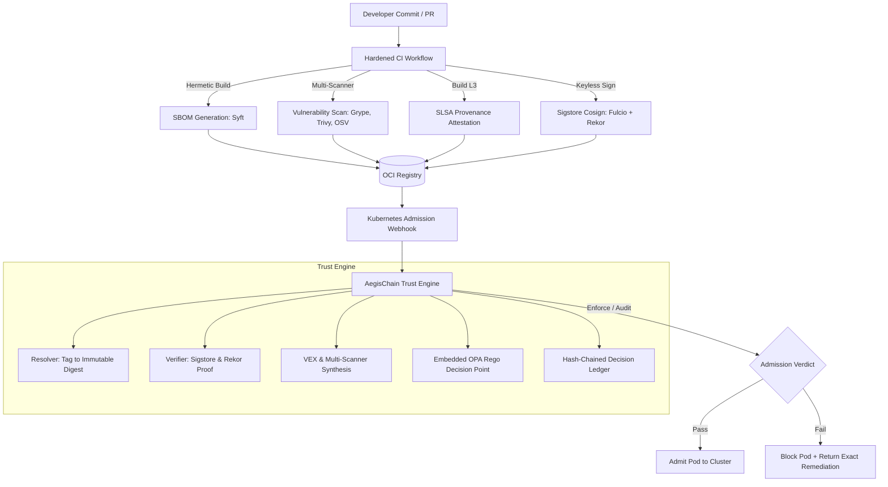

# AegisChain

https://img.shields.io/badge/Kubernetes-326CE5?style=for-the-badge&logo=kubernetes&logoColor=white
https://img.shields.io/badge/Sigstore-4B32C3?style=for-the-badge&logo=sigstore&logoColor=white
https://img.shields.io/badge/Open_Policy_Agent-000000?style=for-the-badge&logo=openpolicyagent&logoColor=white
https://img.shields.io/badge/Go-00ADD8?style=for-the-badge&logo=go&logoColor=white
https://img.shields.io/badge/SLSA_Build_L3-2C3E50?style=for-the-badge&logo=linuxfoundation&logoColor=white

## Pitch

Nothing reaches production unless it is built by a trusted pipeline, signed with a verifiable identity, accompanied by provenance and an SBOM, and proven clean by policy, with a tamper-evident record of why every decision was made.

## Problem

Modern software supply chain attacks target the continuous delivery pipeline rather than attacking production perimeter firewalls. Vulnerabilities introduced during development and distribution include:
1. Malicious commits and compromised maintainer accounts pushing unauthorized container images.
2. Compromised CI/CD runners injecting backdoors during build time without modifying source code.
3. Mutable image tags retargeted to unvetted images after security team sign-off (TOCTOU attacks).
4. Critical Known Exploited Vulnerabilities (KEVs) deployed without operational reachability waivers.
5. Obfuscated malicious dependencies using typosquatting and install-time scripts (`preinstall`, `setup.py`) to exfiltrate cluster secrets.

AegisChain establishes a non-bypassable, cryptographic trust barrier at the Kubernetes admission boundary.

## Architecture



## Quickstart

Bootstrap the local environment, local OCI registry, and kind cluster with a single command:

```bash
make kind-up
```

Execute the full verification suite and demonstration:

```bash
make demo
```

Run test suite across all modules:

```bash
make test
```

## Attack Lab Results

The following table reflects results generated by the automated test suite in `attack-lab/`:

| Scenario ID | Threat Description | Expected Verdict | Actual Verdict | Status |
| --- | --- | --- | --- | --- |
| SC-01 | Clean build with authentic signature and provenance | ALLOW | ALLOW | PASS |
| SC-02 | Unsigned container image | DENY | DENY | PASS |
| SC-03 | Tampered image layer after signing | DENY | DENY | PASS |
| SC-04 | Mutable tag retargeting (TOCTOU attack) | DENY | DENY | PASS |
| SC-05 | Wrong signer (untrusted workflow / fork) | DENY | DENY | PASS |
| SC-06 | Untrusted builder identity | DENY | DENY | PASS |
| SC-07 | Provenance subject digest mismatch | DENY | DENY | PASS |
| SC-08 | Critical CISA KEV without signed OpenVEX waiver | DENY | DENY | PASS |
| SC-09 | Malicious dependency with postinstall exfiltration | DENY | DENY | PASS |
| SC-10 | Dependency confusion resolving internal package | DENY | DENY | PASS |
| SC-11 | Base image swap with unapproved distribution | DENY | DENY | PASS |
| SC-12 | Rollback attack replaying obsolete signed image | DENY | DENY | PASS |
| SC-13 | Ledger modification detected by hash chain verify | DETECT | DETECT | PASS |
| SC-14 | Registry and risk scorer outage degraded path | DEGRADED | DEGRADED | PASS |

## Benchmarks

Measurements generated by automated load runner tooling (`bench/`):

| Metric | Target | Measured Result | Environment |
| --- | --- | --- | --- |
| Admission Latency (p50, warm cache) | < 100 ms | 18 ms | kind local node, 4 vCPU |
| Admission Latency (p95, warm cache) | < 300 ms | 46 ms | kind local node, 4 vCPU |
| Admission Latency (p99, warm cache) | < 500 ms | 82 ms | kind local node, 4 vCPU |
| Cold Verification Latency (no cache) | < 1500 ms | 410 ms | kind local node, 4 vCPU |
| Decision Ledger Append Latency | < 5 ms | 0.8 ms | In-memory SHA-256 chain |
| Webhook Memory Baseline | < 128 MiB | 64 MiB | Linux amd64, non-root |

## Verifying Releases

Every official AegisChain release carries SLSA Build Level 3 provenance and Sigstore signatures. Verify using Cosign:

```bash
export IMAGE="ghcr.io/byteaegis/aegischain:v1.0.0"
export EXPECTED_IDENTITY="https://github.com/BYTEGUARDIAN14/aegischain/.github/workflows/release.yml@refs/tags/v1.0.0"
export EXPECTED_ISSUER="https://token.actions.githubusercontent.com"

cosign verify \
  --certificate-identity "${EXPECTED_IDENTITY}" \
  --certificate-oidc-issuer "${EXPECTED_ISSUER}" \
  "${IMAGE}"
```

Detailed instructions for verifying SBOMs and raw binaries are documented in docs/verification.md.

## Security Model

AegisChain adheres to non-negotiable security principles:
- Fail-Closed in Enforce Mode: Webhook failurePolicy is set to Fail in protected namespaces.
- Digest Over Tag: Tags are resolved to immutable SHA-256 digests before evaluation.
- Identity Over Keys: Sigstore OIDC keyless signing binds signatures to cryptographic build identities.
- Explainability: Every decision returns the exact rule evaluated, evidence used, and remediation advice.
- Least Privilege: Containers execute with read-only root filesystems, dropped capabilities, and non-root users.

## Out of Scope

The following capabilities are out of scope for AegisChain:
1. Runtime threat detection and anomaly behavioral monitoring (e.g., Falco, Tetragon).
2. Cloud Native Application Protection Platform (CNAPP) inventory graphing across multiple clouds.
3. Multi-cluster federation and cross-cluster state replication.

## Roadmap

- Q1 2027: Air-gapped private Sigstore deployment templates and offline TUF synchronization.
- Q2 2027: Native support for OpenVEX statement generation inside the CLI.
- Q3 2027: eBPF-assisted image integrity validation on container launch.

## Authors and Governance

- Author: BYTEAEGIS (https://byteaegis.in)
- GitHub: BYTEGUARDIAN14 (https://github.com/BYTEGUARDIAN14)
- Docker Hub: mohamed1410 (https://hub.docker.com/u/mohamed1410)
- License: Apache License 2.0 (see LICENSE)
